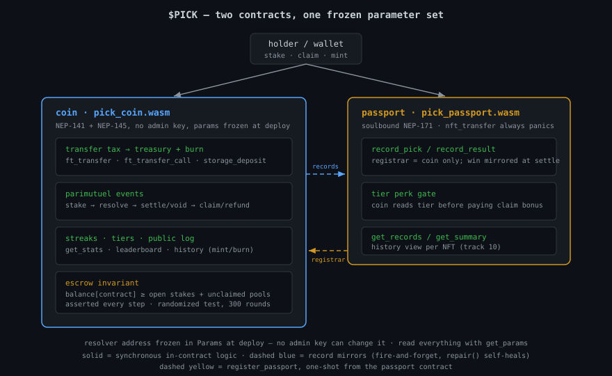
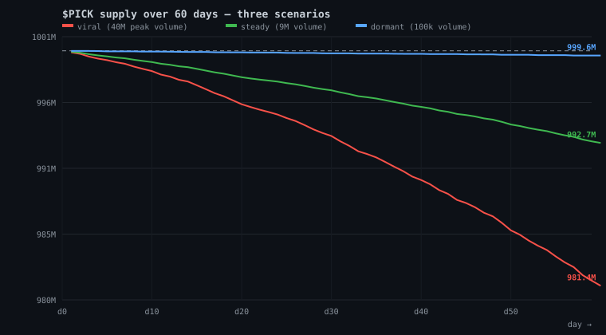

# $PICK — Parimutuel Treasury Memecoin × Prediction Passport

**Tracks:** `memecoins` (primary, track 11) + `nfts` (secondary, track 10)

**Problem:** most memecoins do nothing but trade, and prediction markets
demand a bank account, an oracle subscription and a custodian. $PICK is a
NEP-141 memecoin whose transfer tax funds parimutuel prediction pools
*inside the token contract*: holders stake on events, winners split the pot
plus a treasury bonus, a fixed slice of losing stakes burns, and streaks are
tracked onchain — no backend that someone could switch off. A soulbound
NEP-171 **Prediction Passport** records every pick and unlocks tier bonuses
on claims.

Every parameter is frozen at deploy, readable by anyone via `get_params`, and
**there is no admin key that can change it**.



## Contracts

| Contract | wasm | Purpose |
|---|---|---|
| `coin` | `pick_coin.wasm` | NEP-141 + NEP-145: transfer tax, treasury, events, staking, resolution, claims, streaks, public log |
| `passport` | `pick_passport.wasm` | Soulbound NEP-171: pick/result mirror, tier display, perk gate registered in the coin |

| Address | Network | Role |
|---|---|---|
| `pick-coin.testnet` | testnet | NEP-141 + NEP-145 token — tax, treasury, events, staking, claims |
| `pick-passport.testnet` | testnet | soulbound NEP-171 passport |
| `pick-resolver.testnet` | testnet | resolver frozen into `params.resolver` at deploy — creates and resolves events |

Both contracts are deployed and initialized on testnet, and the frontend
defaults to those two addresses (override per-browser in the settings panel,
stored in `localStorage`). Rebuild/redeploy runbook: [DEPLOY.md](DEPLOY.md).

A complete cycle is already settled on this deployment: event **4** ("Will the
full PICK demo path (mint, stake, resolve, claim) verify on testnet?") took
200,000 PICK on side A and 50,000 PICK on side B, resolved to side A, and paid
**260,009.98 PICK** on claim — 240,000 base (winner side + loser side − 20%
loser burn) plus a 20,010 treasury bonus, which is 2% of the free treasury and
had itself absorbed the 500 PICK left behind by an earlier 1% transfer tax.

```bash
near contract call-function as-read-only pick-coin.testnet get_event \
  json-args '{"event_id": 4}' network-config testnet now
near contract call-function as-read-only pick-passport.testnet get_records \
  json-args '{"user": "pick-team.testnet"}' network-config testnet now
# -> [{ "event_id": 4, "side": 0, "outcome": 1, "payout": "260009980000000" }]
```

## Try it (do X → see Y)

No wallet or deploy needed for steps 1–3.

1. **Run the tests**
   ```bash
   cargo test
   ```
   → see two green result lines — `11 passed; 0 failed` (coin) and
   `4 passed; 0 failed` (passport) — including a randomized 300-round
   lifecycle test that re-asserts the escrow/supply/NEAR-solvency invariants
   after every action.

2. **Run the 60-day simulation**
   ```bash
   python3 simulation/simulate.py
   ```
   → see the summary table printed below and `simulation/out/supply.svg`
   (chart, stdlib-only — no matplotlib required).

3. **Open the UI with fixtures** (from the repository root)
   ```bash
   python3 -m http.server 8742
   # then open http://localhost:8742/frontend/index.html?demo=1
   ```
   → see the full interface (events, odds bars, leaderboard, log, My Passport
   history) served from embedded demo data. A `DEMO · read-only` badge shows
   in the header; every write button answers "writes disabled".

4. **Deploy to testnet** (after step 4 of [DEPLOY.md](DEPLOY.md))
   → set the two contract addresses in the frontend settings panel, reload,
   and see `TOTAL SUPPLY` / `FREE TREASURY` populate from real RPC.

5. **Full user path on testnet**
   → connect wallet → `mint (free)` in the stats bar → see `PASSPORT: minted`
   → stake on a LIVE event → see `your pick:` under the event → after
   `resolve`, claim → see the My Passport table append a `WIN +payout` row and
   the streak counter increment.

6. **Read the frozen parameters**
   ```bash
   # view call, any NEAR RPC explorer or near-cli:
   # contract call_function get_params {}
   ```
   → see the exact parameter table below, identical to what the contracts
   enforce.

Screenshots (from step 3): [docs/demo-top.png](docs/demo-top.png) ·
[docs/demo-passport.png](docs/demo-passport.png)

## Mechanics (exactly as implemented)

**Transfer tax** (user → user only; contract-operated transfers are untaxed):

```
tax   = amount × transfer_tax_bps / 10_000      (100 = 1%)
burn  = tax   × tax_burn_bps / 10_000           (5000 → half the tax burns)
recipient += amount − tax ; treasury += tax − burn ; supply −= burn
```

`ft_transfer` and `ft_transfer_call` require NEP-145 registration
(`storage_deposit`, min 0.005 NEAR). `ft_transfer_call` settles through
`ft_resolve_transfer`: refunds are internal (untaxed) and capped by what the
receiver received, so the tax is charged once.

**Stake** — one pick per user per event (top-ups on the same side; the
opposite side panics). Escrowed stakes sit in the contract's own balance; the
invariants `balance[contract] ≥ escrow` and `Σ balances == total_supply` are
asserted by unit tests after every step.

**Resolve** (resolver, before `resolve_deadline`; either side empty → Void):

```
lose_burn    = losing_side × loser_burn_bps / 10_000     (2000 → 20% burns)
bonus        = free_treasury × event_bonus_bps / 10_000  (200 → 2% of treasury)
winner_pool  = winner_side + losing_side − lose_burn + bonus
```

**Claim** (winners; `claim_window_secs` after resolution, then anyone can
`sweep` the remainder to treasury):

```
payout      = stake_i × winner_pool / winner_side        (u128×u128 via U256)
tier_bonus  = payout × tier_bps / 10_000                 (capped by free treasury)
tier_bps    = 0 without a passport; TRADER ≥ trader_wins wins; ORACLE ≥ oracle_wins
```

**Refund** — Void events, or still-unresolved events after the deadline (the
resolver is *locked out* of late resolutions, so nobody can lose funds to a
missing resolution).

**Streaks** — settled per pick (win → +1, loss → 0). `settle_for` is
permissionless and mirrors the win to the passport at settle time, so records
can't be hidden by refusing to claim (the claim receipt later fills in the
payout amount).

## Trust model & honest limitations (read before judging)

1. **Resolution is centralized by design and documented:** events are created
   and resolved by the `resolver` account frozen in `params.resolver` at
   deploy. It cannot be changed. Its failures are bounded: unresolved events
   auto-refund after `resolve_deadline`. Crypto-price events could be moved to
   a price-feed resolver without touching the staking math (roadmap).
   The sharpest edge of that design: `resolve` only checks
   `resolve_deadline`, **not** `close_ts`, so a malicious resolver could pick
   an outcome while betting is still open. Gating on `close_ts` is a one-line
   change and is on the roadmap; for this demo the resolver is a documented,
   disclosed account rather than an anonymous one.
2. **Passport mirrors are best-effort.** The coin fires `record_pick` /
   `record_result` at the passport as fire-and-forget receipts. The coin's own
   state is authoritative; `passport.repair()` re-registers the perk if the
   mint-time receipt failed, and late results for early picks land as
   "imported" records (`side = null`).
3. **Not implemented (out of scope):** NEP-141 allowances (optional in the
   standard), multi-option events (binary only), fee-on-transfer edge for
   contract-op transfers (intentionally exempt).
4. **Soulbound passport:** `nft_transfer` always panics; one per account.
5. **Sybil limits, plainly:** streaks and pick counts are per-account, so
   splitting funds across accounts splits — but does not multiply — your
   records. The tier bonus is small (1–3%) and capped by actual treasury, so
   self-dealing a bonus costs more in tax than it returns. Pot shares scale
   with stake, which punishes sybil splitting rather than rewarding it.
6. **Storage:** the in-contract history log is capped (2,000 entries, oldest
   drained) — fine at demo scale, swap to an indexer for production. NEP-145
   deposits are held by the contract and refundable via `storage_withdraw` /
   `storage_unregister`.

## Parameters (frozen at deploy)

| Param | Value | Meaning |
|---|---|---|
| `transfer_tax_bps` | 100 | 1% on user→user transfers |
| `tax_burn_bps` | 5000 | half the tax burns |
| `event_bonus_bps` | 200 | 2% of free treasury funds each winner pool |
| `loser_burn_bps` | 2000 | 20% of losing stakes burn |
| `trader_bonus_bps` / `oracle_bonus_bps` | 100 / 300 | claim bonus with passport |
| `trader_wins` / `oracle_wins` | 5 / 10 | tier thresholds |
| `claim_window_secs` | 7 776 000 (90 days) | after which unclaimed pools sweep to treasury |
| `STORAGE_MIN` | 0.005 NEAR | NEP-145 minimum registration deposit |

## Build & test

```bash
cargo check --target wasm32-unknown-unknown   # error-check (near-sdk 5 pattern)
cargo test                                     # 15 unit tests, invariants included
cargo build --target wasm32-unknown-unknown --release
# artifacts: target/wasm32-unknown-unknown/release/{pick_coin,pick_passport}.wasm
# production builds should use `cargo near build` (deterministic, size-optimized)
```

CI ([.github/workflows/ci.yml](.github/workflows/ci.yml)) runs the same three
steps on every push: `cargo test`, wasm release build, and the 60-day
simulation.

## 60-day supply simulation

```bash
python3 simulation/simulate.py        # writes simulation/out/*.csv + supply.svg
```

Daily transfer volume, tax burn, event cadence and win rates simulated over
60 days (seeded, reproducible — `SEED = 42`):

| scenario | volume path | day-60 supply | change | tax burns | loser burns | treasury |
|---|---|---|---|---|---|---|
| viral | 5M → 40M/day | 981,401,255 | **−1.86%** | 6,795,727 | 11,803,019 | 4,511,438 |
| steady | 8M → 9M/day | 992,710,608 | **−0.73%** | 2,568,184 | 4,721,207 | 1,490,947 |
| dormant | 500k → 100k/day | 999,623,923 | **−0.04%** | 88,620 | 287,457 | 74,334 |



Read: under even viral volume the tax+loser burns remove <2% of supply in 60
days while the treasury funds every winner pool; the mechanic is a slow bleed
with a rule, not a hyperinflation schedule.

## Verification

| Check | Evidence |
|---|---|
| Unit tests | `cargo test` → 15/15 (registration gates, `ft_transfer_call` refund paths, callback guards, force-unregister burn, win-mirror payout fill, soulbound transfer, randomized 300-round invariant test) |
| Wasm build | `cargo build --target wasm32-unknown-unknown --release` → both artifacts compile |
| Simulation | `python3 simulation/simulate.py` → table above + `supply.svg` |
| CI | `.github/workflows/ci.yml` — test + wasm + simulation jobs |
| Frontend | zero-build single file; `?demo=1` fixtures let anyone click through without a wallet |
| Cross-contract ordering | unit tests cover both orders of settle/claim mirror (win lands at settle, payout filled by claim; late duplicate ignored) |

## Track requirements → evidence

**Track 11 · Memecoins With Mechanics** (`memecoins`) —
[track prompt](https://github.com/nearai/near-hackathon-prompt-examples/blob/main/tracks/11-memecoins.md)

| Requirement | Evidence |
|---|---|
| NEP-141 token, mechanic in the contract (not a switchable backend) | `coin/src/lib.rs`: tax/burn/stake/resolve/claim are synchronous contract calls; `ft_transfer`, `ft_transfer_call`, NEP-145 storage all in-contract |
| Parameters set at launch, readable by anyone, no admin key | `get_params`; `Params` has no setters; resolver address frozen at `Coin::new` |
| Supply reacts / treasury with rules | tax → treasury → winner-pool bonus + loser burn, formulas above |
| Streaks + mint/burn log on a page | `get_stats` / `get_leaderboard` / `get_history`; frontend sections "Streak leaderboard" and "Onchain log" |
| Simulate 60 days, show supply under scenarios | table + `simulation/out/supply.svg` above, reproducible with `SEED=42` |
| Sybil limits stated plainly | "Trust model & honest limitations" item 5 |

**Track 10 · NFTs That Do Something** (`nfts`) —
[track prompt](https://github.com/nearai/near-hackathon-prompt-examples/blob/main/tracks/10-nfts.md)

| Requirement | Evidence |
|---|---|
| NFT carries credentials/behavior, not a JPEG | passport records picks, results, tier; tier changes payout math in the coin |
| History view per NFT | frontend "My Passport" section: `get_records` + `get_summary` table (works in `?demo=1`) |
| Ownership with behavior | soulbound: `nft_transfer` panics (test `soulbound_transfer_always_panics`) |
| Standard-compliant | NEP-171: `nft_token`, `nft_metadata`, `nft_transfer_call`/`nft_resolve_transfer`, `nft_total_supply`, `nft_supply_for_owner` |

## Libraries & credits (Q-005)

- [near-sdk](https://github.com/near/near-sdk) 5.30 — contract framework
  (serde, borsh, testing utilities)
- [borsh](https://github.com/near/borsh-rs) / serde — state & JSON serialization
- [NEP-141](https://github.com/near/NEPs/blob/master/neps/nep-0141.md),
  [NEP-145](https://github.com/near/NEPs/blob/master/neps/nep-0145.md),
  [NEP-171](https://github.com/near/NEPs/blob/master/neps/nep-0171.md) — the
  standards implemented here
- [wallet-selector](https://github.com/near/wallet-selector) 8.9.1 (MyNearWallet
  module, loaded from esm.sh in the frontend)
- Simulation, SVG chart and frontend are stdlib-only Python / vanilla JS — no
  build step, no framework

## Demo script (40s)

1. `ft_transfer` → tax splits live, supply ticks down, history log appends
2. `stake` both sides of an open event → implied odds move
3. `resolve` → loser burn fires, winner pool shows the treasury bonus
4. `claim` → payout + tier bonus, streak increments, My Passport row fills in
5. Passport: record + tier (`ROOKIE → TRADER → ORACLE`)
6. README chart: 60-day supply under three scenarios (embed above)

## Submission checklist

- [ ] Repository is public and this README matches actual behavior
- [ ] Both contracts deployed to testnet; addresses filled in above
- [ ] Frontend hosted (GitHub Pages on this repo) and reachable
- [ ] Demo posted on X: built at NEAR HACKATHON, tags @NEARProtocol +
      #NEARHackathon, video/screenshots attached
- [ ] Submission sent (tracks `["memecoins","nfts"]`) before **14 Nov 2026 ·
      23:59 UTC** — payload confirmed with the human first, per
      [HACKATHON.md](HACKATHON.md)

## Roadmap

- Price-feed resolver for crypto events (removes the last trusted party)
- NEP-141 allowances
- Merkle batch claims for large pots
- Passport `sync()` that re-pulls missed records from the coin
